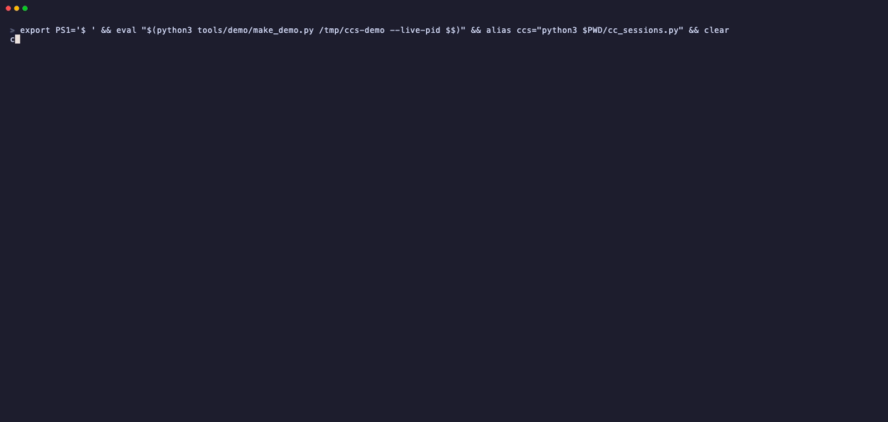

# cc-sessions

**Clean up Claude Code without losing work you forgot you had.**



Heavy [Claude Code](https://claude.com/claude-code) use leaves a trail: ~400 MB of RAM per open session, transcripts piling up in `~/.claude`, and per-session scratchpads in `/tmp` full of cloned repos. On my machine that was 1.9 GB on disk, and one forgotten clone held 3 commits that existed nowhere else.

- **See everything**: running sessions and their RAM, transcripts, and `/tmp` scratchpads with cloned repos
- **Know what each session was**: titles, tokens, first prompt, and the exact `claude --resume` command
- **Never touches live sessions**, even with `--force`
- **Flags clones with unpushed, uncommitted or unreadable work**, and shows you the commits before you can delete them
- **Saves before deleting**: git bundle, patch and untracked files, so you can restore them
- **Logs every deletion**, so "what did I delete?" has an answer

Type `ccs` and use the arrow keys, or just ask Claude to "clean up my sessions".

Single Python file, standard library only. macOS and Linux.

```
▍Sessions  105 · 1.7G on disk

    #     SIZE  IDLE  TITLE                                  PROJECT
    1   657.2M   <1m  Node 24 migration                      web/api            ● live
    2   313.6M    4h  Fix auth on public routes              infra              ⚠ cfg: 3 unpushed commit(s)
    3   207.8M    7d  Checkout screen redesign               android/app
```

## Install

**As a Claude Code plugin** (recommended):

```
/plugin marketplace add droiddevgeeks/cc-sessions
/plugin install cc-sessions@cc-sessions
```

That gives you the `/sessions` skill straight away. For the `ccs` terminal command too, ask Claude to "install the ccs command" or run once:

```bash
python3 ~/.claude/plugins/cache/cc-sessions/cc-sessions/*/cc_sessions.py install-cli
```

It writes small launchers to `~/.local/bin` that always run the newest installed plugin version, so `/plugin update` needs no reinstall.

**From git** (if you want to hack on it):

```bash
git clone https://github.com/droiddevgeeks/cc-sessions.git
cd cc-sessions && bash install.sh
```

This symlinks `cc-sessions` and `ccs` into `~/.local/bin` and the `/sessions` skill into `~/.claude/skills`, so `git pull` updates all of it. `bash install.sh --uninstall` removes the links (never your data). Use one method or the other, not both, or you'll have two `/sessions` skills.

Needs Python 3.9+. Nothing to pip install.

## Use

Type `ccs` and choose with ↑↓ / Enter:

```
▍cc-sessions  what do you want to do?
  ❯ 1  Overview — processes, disk, everything
    2  List sessions
    3  Inspect a session
    4  Clean old scratch (preview first)
    5  Pick sessions to delete
    6  Kill leftover processes
    7  Deletion log & rescued work
    q  Quit
```

In *Pick*, Space ticks sessions, `a` ticks all, Enter confirms. Esc goes back from anywhere.

Or ask Claude Code: "clean up my sessions", "what's eating RAM", "find the session where I worked on X", or `/sessions`.

### Commands (for scripts)

| Command | Does |
|---|---|
| `cc-sessions overview` | Processes + transcripts + scratchpads |
| `cc-sessions ps` | Live processes, RAM, session name/status |
| `cc-sessions disk [--all]` | Disk use, with clone status per scratchpad |
| `cc-sessions ls [--all]` | Numbered session list with titles |
| `cc-sessions show <#\|sid>` | One session: tokens, first prompt, clones, resume command |
| `cc-sessions clean --scratch 3d` | Preview deleting scratch idle > 3 days |
| `cc-sessions clean --scratch 3d --yes` | Actually delete |
| `cc-sessions clean --transcripts 14d --yes` | Delete old transcripts (no more `/resume` for them) |
| `cc-sessions clean --only <sid> --yes` | One session |
| `cc-sessions kill <pid>…` | SIGTERM Claude processes |
| `cc-sessions log [-n N]` | What was deleted, when, and where rescued work went |

Ages: `3d`, `12h`, or a bare number of days.

## Safety

- **Preview by default.** `clean` deletes nothing without `--yes`; the menu and pick make you type `yes`.
- **Live sessions are never deleted**, even with `--force`.
- **Clones with unpushed commits, uncommitted changes, no remote, or an unreadable `.git` are skipped.** To delete them anyway, *pick* shows the at-risk commits and makes you type the clone's name; scripts need `--force`.
- **At-risk work is saved before it's deleted.** Unpushed commits go to a git bundle, uncommitted changes to a `.patch`, untracked files to a `.tar`, all in `~/.claude/cc-sessions-rescue/`. If saving fails, the folder is not deleted. Restore with `git clone <file>.bundle restored` or `git apply <file>.patch`. An unreadable repo can't be saved; it's deleted only on explicit confirmation and noted as such.
- **Every deletion is logged** to `~/.claude/cc-sessions.log` (JSON lines): when, what, title, size, rescued files. `cc-sessions log` shows it.
- `kill` refuses the session you run it from and anything that isn't a Claude process. "Kill leftovers" only targets orphaned tool shells, never a background session.
- Scratch-only deletes keep transcripts, so `claude --resume` still works.

## Develop

```bash
python3 -m unittest -v    # unit tests (git is exercised for real, not mocked)
```

Env overrides: `CLAUDE_CONFIG_DIR` (default `~/.claude`), `CC_SESSIONS_SCRATCH` (scratch root), `NO_COLOR`.
